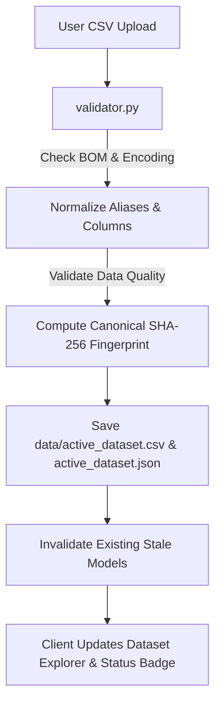

# AgriSense Analytics — System Architecture & Implementation Guide

## 1. Executive Summary & Architectural Overview

AgriSense Analytics is an enterprise-grade agricultural analytics and crop recommendation platform developed for the Principles of Data Science (PoDS) curriculum. It pairs a high-performance Flask/Python backend with a responsive vanilla HTML5, CSS3, and JavaScript frontend.

### Core Architectural Principles
- **Separation of Concerns**: Strict boundary between data ingestion ([validator.py](file:///c:/Users/jmsar/OneDrive/Desktop/Pods%20mini%20project/validator.py)), algorithm training/inference ([pipeline.py](file:///c:/Users/jmsar/OneDrive/Desktop/Pods%20mini%20project/pipeline.py)), HTTP/database routing ([server.py](file:///c:/Users/jmsar/OneDrive/Desktop/Pods%20mini%20project/server.py)), and client-side presentation ([frontend/](file:///c:/Users/jmsar/OneDrive/Desktop/Pods%20mini%20project/frontend)).
- **Zero-Leakage ML Pipeline**: Cross-validation scaling occurs strictly within training folds; held-out test data is never accessed during preprocessing or champion selection.
- **Universal CSV Compatibility**: Robust normalization layer accepting arbitrary column ordering, casing, whitespace, UTF-8 BOM encoding, and documented agronomic aliases.
- **Strict Single Source of Truth**: Dynamic SHA-256 dataset fingerprinting links active models directly to the active dataset, preventing stale inferences.
- **Persistent SQLite Audit Logging**: Authentic prediction tracking surviving browser refreshes and process restarts.

---

## 2. Directory Layout

```text
AgriSense-Analytics/
├── server.py                   # Flask API, routing, SQLite persistence, static serving
├── pipeline.py                 # Custom algorithms, scaling, splitting, CV champion selection
├── validator.py                # Schema validation, alias mapping, data-quality audits
├── requirements.txt            # Runtime dependencies (Flask, pandas, numpy, gunicorn)
├── README.md                   # Project documentation & audit report
├── .gitignore                  # Git hygiene and secret exclusion rules
├── .env.example                # Environment configuration template
├── render.yaml                 # Render cloud deployment specification
├── frontend/                   # Client-side user interface
│   ├── index.html              # Accessible single-page application shell
│   ├── css/                    # Modular stylesheet tokens, layout, and responsiveness
│   │   ├── tokens.css          # Approved 4-color palette tokens & typography
│   │   ├── base.css            # Base element styling & CSS resets
│   │   ├── layout.css          # Grid layouts, app container, and sidebar structure
│   │   ├── components.css      # Cards, form inputs, badges, modals, and buttons
│   │   └── responsive.css      # Desktop, tablet, and mobile media queries
│   ├── js/                     # Modular vanilla JavaScript controllers
│   │   ├── app.js              # Application bootstrapper
│   │   ├── navigation.js       # View transitions & panel state management
│   │   ├── dataset-parser.js   # Client file upload, validation, and preview
│   │   ├── model-evaluation.js # Training authorization & CV metric rendering
│   │   ├── prediction-form.js  # Feature validation & inference submission
│   │   ├── prediction-history.js # SQLite history fetching, rendering, and clearing
│   │   └── icons.js            # Inline accessible SVG iconography
│   └── assets/                 # Static imagery and logos
├── data/                       # Ingested datasets and SQLite audit trail
│   └── README.md
├── models/                     # Serialized JSON model artifacts and metadata
│   └── README.md
├── tests/                      # Automated test suite (44 tests passing)
│   ├── test_validator.py       # Dataset validation and alias normalization tests
│   ├── test_pipeline.py        # Custom ML algorithm and CV non-leakage tests
│   ├── test_api.py             # Flask REST endpoint lifecycle tests
│   ├── test_frontend.py        # Static asset serving and design token tests
│   └── test_pods_system.py     # Master 24-point regression suite
└── docs/                       # Architectural documentation
    └── project-architecture.md
```

---

## 3. Data Flow & Universal Ingestion



### Canonical Feature Schema
- **Nitrogen ($N$)**: Soil nitrogen content ratio ($[0, 140]$)
- **Phosphorus ($P$)**: Soil phosphorus content ratio ($[5, 145]$)
- **Potassium ($K$)**: Soil potassium content ratio ($[5, 205]$)
- **Temperature**: Ambient temperature in °C ($[8.8, 43.7]$)
- **Relative Humidity**: Atmospheric relative humidity in % ($[14.2, 100.0]$)
- **Soil pH**: Soil acidity index ($[3.5, 9.9]$)
- **Rainfall**: Annualized/seasonal precipitation in mm ($[20.2, 298.6]$)
- **Label**: Target crop variety identifier (22 species in Kaggle benchmark)

---

## 4. Machine Learning Implementation Details

### Custom Algorithms (from Scratch)
1. **Decision Tree (CART Classifier)**:
   - Split optimization via Gini Impurity:
     $$I_G(p) = 1 - \sum_{i=1}^{C} p_i^2$$
   - Node partitioning evaluates all midpoints of sorted unique feature values.
   - Pre-pruning parameters: `max_depth=12`, `min_samples_split=4`.

2. **Random Forest Classifier**:
   - Ensemble of $B=25$ decorrelated CART decision trees.
   - Bootstrap bagging (sampling $N$ observations with replacement).
   - Feature subsampling: $\lfloor\sqrt{d}\rfloor$ features evaluated per split.
   - Aggregation via hard majority voting.

3. **K-Nearest Neighbors (KNN)**:
   - Euclidean feature distance with uniform neighbor weighting.
   - Strict requirement for feature scaling via `StandardScalerModel` to prevent dimensional bias.

### Leak-Free Validation & Champion Selection
- **Stratified Partitioning**: 80% train / 20% held-out test split with seed 42.
- **Fold Scaling**: `StandardScalerModel` is fitted exclusively on the training folds in cross-validation and exclusively on the 80% training partition for final test evaluation.
- **Champion Selection Criterion**: Highest mean Stratified 5-Fold Cross-Validation Macro-F1 score strictly on the training partition. Held-out test metrics have **0% weight** in model selection.

---

## 5. REST API Reference

| Endpoint | Method | Payload / Params | Response Summary |
| :--- | :---: | :--- | :--- |
| `/api/health` | `GET` | None | `{ "status": "healthy", "service": "..." }` |
| `/api/dataset-status` | `GET` | None | Metadata of currently active dataset or uninitialized status |
| `/api/validate-dataset` | `POST` | Multipart Form: `file` | Schema audit, row count, class list, canonical fingerprint |
| `/api/dataset-reset` | `POST` | None | Clears active dataset AND removes dependent model artifacts |
| `/api/train-models` | `POST` | `{ "approved_by_user": true, ... }` | Evaluates 3 models via 5-fold CV, selects champion, persists weights |
| `/api/model-status` | `GET` | None | Reports champion algorithm, validity, and fingerprint compatibility |
| `/api/predict` | `POST` | `{ "features": { "N": 90, ... } }` | Validates bounds, performs inference, logs to SQLite audit trail |
| `/api/prediction-history` | `GET` | None | All inference audit records in reverse chronological order |
| `/api/prediction-history/clear`| `POST` | None | Truncates SQLite audit trail table |

---

## 6. Render Deployment Guide

The repository includes `render.yaml` for zero-configuration deployment to Render:

1. **Connect Repository**: Link `https://github.com/Sanjai-E242/AgriSense-Analytics.git` in the Render Dashboard.
2. **Select Web Service**: Render automatically detects `render.yaml` and sets:
   - **Environment**: Python
   - **Build Command**: `pip install -r requirements.txt`
   - **Start Command**: `gunicorn server:app`
3. **Dynamic Port Binding**: `server.py` reads `os.environ.get("PORT", 5000)`, binding correctly to Render's dynamically assigned port.
